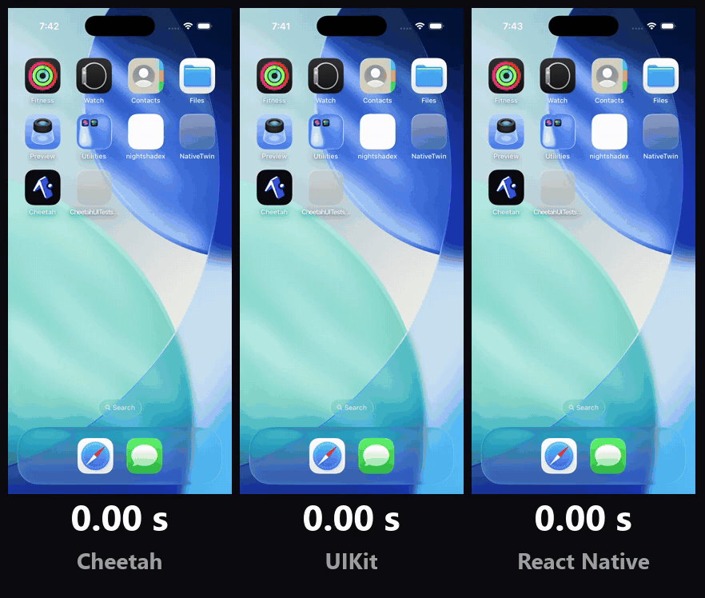

Rust runtime that drives native Android and iOS views with no JavaScript.

## Performance

The same app, Nightshade, built three ways, launching side by side:

| | Cheetah | UIKit | React Native |
|---|---|---|---|
| Launch to first screen | **0.9 s** | 1.0 s | 2.4 s |
| Memory | **133 MB** | 131 MB | 230 MB |
| CPU while scrolling | **2.9 s** | 2.6 s | 5.9 s |

iOS 26 simulator on GitHub Actions. Same screens, data and taps in all three.
[How it's measured](https://github.com/maxcabd/nightshade-react-bench).
