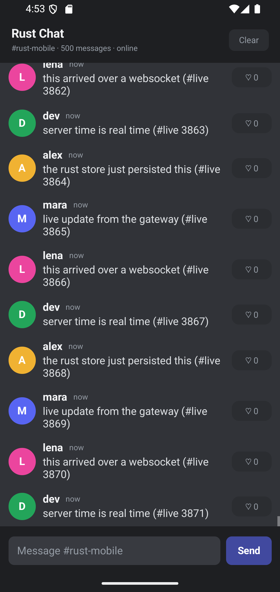

# Cheetah Android host

The Android app is a native Android host for the Rust runtime. The Rust core owns state, layout, and diffs; Kotlin realizes the resulting `create`, `update`, `children`, `layout`, and `remove` operations with platform views.



## Build

```bash
./build-android.ps1
```

On macOS/Linux, build the Rust libraries with the Android targets and run Gradle:

```bash
cargo build -p runtime --target x86_64-linux-android --release
cargo build -p runtime --target aarch64-linux-android --release
cd android
./gradlew :app:assembleDebug
```

Install the debug APK with `adb install -r android/app/build/outputs/apk/debug/app-debug.apk`.

## Gateway

```bash
adb reverse tcp:9001 tcp:9001
cargo run -p gateway
```

The host connects to `ws://127.0.0.1:9001`.

## Edge-to-edge

On Android 11 / API 30 and newer, the activity runs edge-to-edge:

- `setDecorFitsSystemWindows(false)` and transparent system bars.
- The host reads the system-bar and IME insets and sends the same `host` capability event used on iOS.
- Rust places the floating header/composer from those insets and adds matching scroll padding.
- The header/composer are opaque fallbacks for the iOS glass surfaces; small controls keep their translucent tint.

On API 24–29 the host keeps the original `fitsSystemWindows` layout and native `adjustResize` behavior.

The activity pauses and resumes the Rust gateway with `onStop` / `onStart`, so the WebSocket and reconnect loop stop while backgrounded and the outbox flushes on return.

## What is implemented

- Shared Rust actor and op protocol with the iOS host.
- Native text measurement through `StaticLayout` with a Rust-side cache.
- Virtualized variable-height list slots, scroll callbacks, scroll-to-bottom, connection status, and offline outbox.
- Host capability handshake for safe areas, keyboard insets, and floating chrome.
- Lifecycle pause/resume and accessibility IDs for Rust-driven controls.
