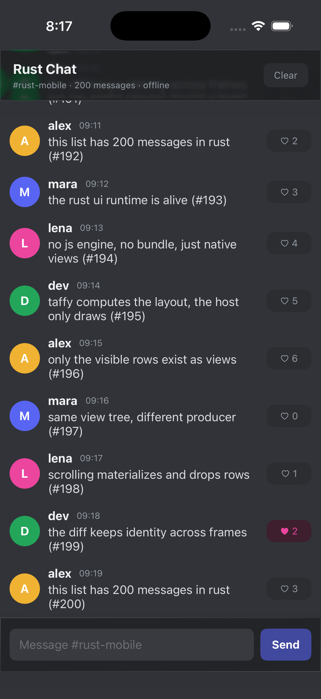

# Cheetah iOS host

The iOS app is a UIKit host for the same Rust actor and op protocol used on Android. It does not use SwiftUI or React Native.



## Build on a Mac

```bash
cd ios
bash build-rust.sh

brew install xcodegen
xcodegen generate
open Cheetah.xcodeproj
```

Build with Xcode 26 to get Liquid Glass. Select a signing team in Xcode, then run on a simulator or device.

`build-rust.sh` compiles the Rust core for device and simulator architectures and creates `ios/Libs/Runtime.xcframework`. The Xcode target links that XCFramework.

## Gateway

Run the local gateway on the Mac:

```bash
cargo run -p gateway
```

The iOS Simulator shares the Mac's loopback, so `ws://127.0.0.1:9001` works as-is. For a physical device, change the gateway URL in `Cheetah/RustHost.swift` to the Mac's LAN address and add the appropriate ATS exception.

## Liquid Glass

On iOS 26, the header and composer are rendered as Liquid Glass containers using `UIGlassEffect`. The list extends underneath both bars and scrolls behind the material. Clear and Send are interactive glass controls.

The same Rust `glass()` nodes fall back to `UIBlurEffect` on iOS 16–25. When Reduce Transparency is enabled, they render as an opaque panel instead. The app does not set `UIDesignRequiresCompatibility`, so system components on iOS 26 are free to adopt the new design as well.

## Host layout contract

Before the first resize, the host sends a `host` event. iOS sends it full-screen with the real safe-area and keyboard insets:

```json
{
  "safeTop": 59,
  "safeBottom": 34,
  "keyboardInset": 0,
  "overlayChrome": true,
  "glass": true,
  "scale": 3
}
```

Rust uses `safeTop`, `safeBottom`, and `keyboardInset` to size the floating chrome, set list content insets, and clamp scroll offsets. `overlayChrome` selects the floating-chrome layout; Android currently sends `false` because its root uses `fitsSystemWindows` and native resize handling. The demo no longer branches on the target OS.

When the keyboard opens, the controller re-sends the host info with `keyboardInset`, so the composer moves above the keyboard and the list keeps its final rows visible.

The host also sends lifecycle commands through `cheetah_lifecycle` / `nativeLifecycle`. Backgrounding pauses the WebSocket and reconnect loop without destroying the Rust app state. Sending messages are persisted back to `queued`; foregrounding reconnects and flushes the outbox. Draft text and scroll position remain in memory and on screen.

## What is implemented

- C ABI (`cheetah_new`, `cheetah_resize`, `cheetah_event`, `cheetah_lifecycle`, `cheetah_free`) over the shared Rust core.
- Ops callback posts JSON to the main queue.
- CoreText text measurement callback on the actor thread.
- Native `UILabel`, custom `UIControl` buttons, `UITextField`, and `UIScrollView` views driven by absolute frames.
- Glass containers, vibrancy through `UIVisualEffectView.contentView`, blur/opaque fallbacks, and interactive glass controls.
- Overlay header/composer with scroll content insets, so messages scroll beneath the chrome.
- Host capability handshake for safe areas, keyboard insets, glass availability, and display scale.
- Lifecycle pause/resume for the gateway, with outbox replay on foreground.
- Stable accessibility identifiers for Rust-driven controls.
- Variable-height list slots, scroll callbacks, scroll-to-bottom, connection status, and offline outbox from the shared core.

## Verification

CI runs on macOS 26 with Xcode 26, builds the Rust XCFramework, builds both device and simulator targets, launches the app in an iOS 26 simulator, publishes the screenshot above, and runs UI tests for sending a message and preserving a draft across backgrounding. The app has not yet been run on a physical device.
